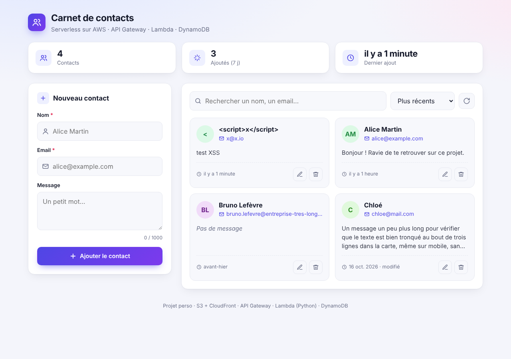
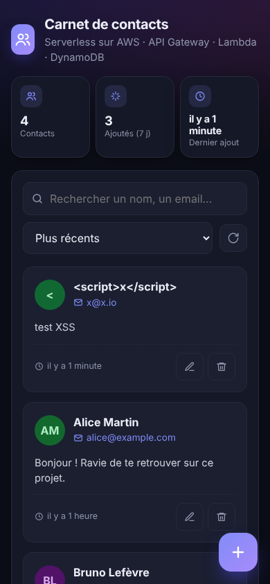
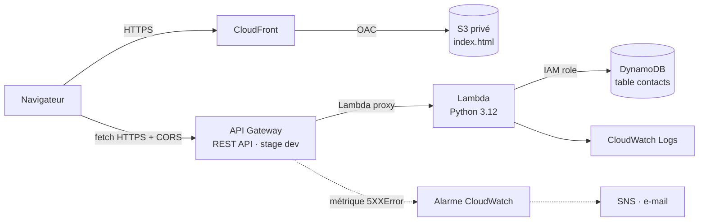

# Carnet de contacts — API REST serverless sur AWS

Application web de gestion de contacts (CRUD complet) construite **entièrement en serverless** sur AWS : un front statique servi par CloudFront, une API REST exposée par API Gateway, une logique métier en Python sur Lambda, des données dans DynamoDB et un monitoring CloudWatch.

> Projet personnel réalisé dans le cadre de ma reconversion vers le cloud, pour passer de la théorie (AWS Cloud Practitioner) à la mise en pratique : construire, déployer, **déboguer** et sécuriser une vraie stack de bout en bout.

**Démo :** https://d3nr9tsgqdutgs.cloudfront.net
   
   

---

## Sommaire

- [Architecture](#architecture)
- [Fonctionnalités](#fonctionnalités)
- [Stack technique](#stack-technique)
- [Endpoints de l'API](#endpoints-de-lapi)
- [Déploiement](#déploiement)
- [Sécurité](#sécurité)
- [Monitoring](#monitoring)
- [Problèmes rencontrés et résolutions](#problèmes-rencontrés-et-résolutions)
- [Compétences mobilisées](#compétences-mobilisées)
- [Limites connues et prochaines étapes](#limites-connues-et-prochaines-étapes)

---

## Architecture



**Flux d'une requête :**

1. L'utilisateur charge la page depuis **CloudFront**, qui lit `index.html` dans un **bucket S3 privé** via une *Origin Access Control* (le bucket n'est jamais exposé publiquement).
2. La page appelle l'API avec `fetch()`. **API Gateway** transmet la requête complète à **Lambda** (intégration proxy).
3. La **Lambda** route selon la méthode HTTP et le paramètre `{id}`, puis lit ou écrit dans **DynamoDB** avec les droits de son **rôle IAM**.
4. Chaque exécution est journalisée dans **CloudWatch Logs** ; une **alarme** sur les erreurs 5XX d'API Gateway envoie un e-mail via **SNS**.

Région : `eu-north-1` (Stockholm).

---

## Fonctionnalités

- Ajouter un contact (nom, email, message)
- Lister les contacts, triés du plus récent au plus ancien, avec recherche instantanée
- Modifier un contact (mise à jour partielle)
- Supprimer un contact
- Validation côté client (nom obligatoire, format d'email), messages de confirmation et d'erreur
- Protection contre l'injection HTML (XSS) à l'affichage

---

## Stack technique

| Couche | Service | Rôle |
|---|---|---|
| Front | **S3** + **CloudFront** | Hébergement statique privé, HTTPS, cache CDN |
| API | **API Gateway** (REST) | Routage HTTP, CORS, stage `dev` |
| Calcul | **Lambda** (Python 3.12, boto3) | Logique CRUD |
| Données | **DynamoDB** (on-demand) | Stockage NoSQL, clé de partition `id` |
| Sécurité | **IAM** | Rôle d'exécution Lambda, resource-based policy, bucket policy |
| Observabilité | **CloudWatch** Logs, Logs Insights, Alarms + **SNS** | Journaux, requêtes, alertes e-mail |
| Front-end | HTML / CSS / JavaScript (vanilla) | Interface sans framework ni dépendance |

---

## Endpoints de l'API

Base URL : `https://<api-id>.execute-api.eu-north-1.amazonaws.com/dev`

| Méthode | Route | Description | Codes de retour |
|---|---|---|---|
| `POST` | `/contacts` | Crée un contact (`id` UUID et `createdAt` générés côté serveur) | `201`, `500` |
| `GET` | `/contacts` | Liste tous les contacts | `200` |
| `GET` | `/contacts/{id}` | Récupère un contact | `200`, `404` |
| `PUT` | `/contacts/{id}` | Met à jour les champs envoyés (`nom`, `email`, `message`) | `200`, `400`, `404` |
| `DELETE` | `/contacts/{id}` | Supprime un contact | `200` |

**Exemples :**

```bash
BASE_URL="https://<api-id>.execute-api.eu-north-1.amazonaws.com/dev"

# Créer
curl -X POST "$BASE_URL/contacts" -H "Content-Type: application/json" \
  -d '{"nom": "Alice", "email": "alice@example.com", "message": "Bonjour"}'

# Lister
curl "$BASE_URL/contacts"

# Modifier uniquement l'email
curl -X PUT "$BASE_URL/contacts/<id>" -H "Content-Type: application/json" \
  -d '{"email": "nouvel.email@example.com"}'

# Supprimer
curl -X DELETE "$BASE_URL/contacts/<id>"
```

**Choix d'implémentation notables dans la Lambda :**

- `{**body, "id": uuid4()}` : l'`id` généré écrase toujours celui qu'un client pourrait envoyer, il est donc impossible d'imposer ou d'écraser un identifiant.
- **PUT** avec `ConditionExpression="attribute_exists(id)"` : `update_item` crée l'item s'il n'existe pas (comportement *upsert*). La condition empêche de créer un contact fantôme et renvoie un `404`.
- **PUT** construit dynamiquement l'`UpdateExpression` à partir des seuls champs autorisés et présents, avec des alias `#champ` pour éviter les mots réservés DynamoDB (`name`…).
- `ReturnValues="ALL_NEW"` : l'item mis à jour est renvoyé directement, sans second appel `get_item`.
- `json.dumps(..., default=str)` : gère les `Decimal` renvoyés par DynamoDB pour les nombres.

---

## Déploiement

Déploiement manuel via la console AWS et la CLI (CloudShell).

1. **DynamoDB** : table `contacts`, clé de partition `id` (String), capacité on-demand.
2. **IAM** : rôle d'exécution pour Lambda avec `AWSLambdaBasicExecutionRole` (logs) et un accès DynamoDB.
3. **Lambda** : fonction `contacts-api`, runtime Python 3.12, handler `lambda_function.handler`.
4. **API Gateway** : REST API régionale, ressources `/contacts` et `/contacts/{id}`, intégration *Lambda proxy*, CORS activé, déploiement sur le stage `dev`.
5. **Permission d'invocation** : autoriser API Gateway à appeler la Lambda :
   ```bash
   aws lambda add-permission \
     --function-name contacts-api \
     --statement-id apigateway-invoke \
     --action lambda:InvokeFunction \
     --principal apigateway.amazonaws.com \
     --source-arn "arn:aws:execute-api:eu-north-1:<account-id>:<api-id>/*/*/*"
   ```
6. **S3** : bucket privé (Block Public Access activé), upload de `index.html`.
7. **CloudFront** : distribution avec origine S3 en **OAC**, redirection HTTP → HTTPS, objet racine `index.html`. La bucket policy n'autorise que cette distribution.
8. **Mise à jour du front** :
   ```bash
   aws s3 cp index.html s3://<bucket>/
   aws cloudfront create-invalidation --distribution-id <distribution-id> --paths "/*"
   ```

---

## Sécurité

- **Bucket S3 privé** : aucun accès public ; seule la distribution CloudFront peut lire les objets (OAC + condition `AWS:SourceArn` dans la bucket policy).
- **HTTPS partout** : CloudFront redirige HTTP vers HTTPS ; API Gateway n'expose que du HTTPS.
- **Séparation des permissions** :
  - le **rôle d'exécution** définit ce que la Lambda peut faire (DynamoDB, logs) ;
  - la **resource-based policy** définit qui peut invoquer la Lambda (uniquement cette API Gateway).
- **Pas d'usage du compte root** : travail quotidien avec un utilisateur IAM dédié.
- **XSS** : toutes les données affichées dans la page sont échappées.

---

## Monitoring

- **CloudWatch Logs** (`/aws/lambda/contacts-api`) : chaque invocation produit `START`, les logs applicatifs (`print`), `END` et `REPORT` (durée, durée facturée, mémoire, *cold start* via `Init Duration`).
- **Alarme CloudWatch** sur la métrique **`5XXError` d'API Gateway** (≥ 1 sur 5 min), avec notification e-mail via SNS.
- **Logs Insights** :

  ```
  # Erreurs (le code journalise en français : "Erreur:")
  fields @timestamp, @message
  | filter @message like /(?i)(erreur|error)/
  | sort @timestamp desc
  | limit 20
  ```

  ```
  # Performances
  fields @timestamp, @duration
  | filter @type = "REPORT"
  | stats avg(@duration), max(@duration) by bin(5m)
  ```

---

## Problèmes rencontrés et résolutions

C'est la partie du projet où j'ai le plus appris. Chaque problème est décrit avec son symptôme, la manière dont je l'ai diagnostiqué et la solution.

### 1. Mauvais runtime Lambda
- **Symptôme :** `Runtime.ImportModuleError: Cannot find module 'index'`.
- **Diagnostic :** les logs mentionnaient `Node.js` alors que mon code était en Python : la fonction avait été créée avec le runtime par défaut.
- **Solution :** recréation de la fonction en **Python 3.12**.
- **À retenir :** lire l'environnement d'exécution dans les logs avant de chercher l'erreur dans le code.

### 2. Handler introuvable
- **Symptôme :** `Runtime.HandlerNotFound: Handler 'lambda_handler' missing on module 'lambda_function'`.
- **Diagnostic :** Lambda cherche par défaut `lambda_function.lambda_handler`, ma fonction s'appelait `handler`.
- **Solution :** configuration du handler en `lambda_function.handler` (format `fichier.fonction`).

### 3. Accès refusé à DynamoDB
- **Symptôme :** `AccessDeniedException ... no identity-based policy allows the dynamodb:PutItem action`.
- **Diagnostic :** le rôle d'exécution de la Lambda n'avait aucune policy DynamoDB.
- **Solution :** ajout des permissions DynamoDB au rôle.
- **À retenir :** différence entre une **erreur de code** et une **erreur de permission** ; le message IAM indique précisément l'action, la ressource et l'identité concernées.

### 4. API Gateway ne peut pas invoquer la Lambda
- **Symptôme :** `{"message": "Internal server error"}` en anglais (donc généré par API Gateway, pas par mon code qui répond en français).
- **Diagnostic :** l'onglet **Test** d'API Gateway affichait `Invalid permissions on Lambda function`. En recréant la fonction, j'avais perdu la permission d'invocation.
- **Solution :** `aws lambda add-permission` avec le principal `apigateway.amazonaws.com`.
- **À retenir :** le **rôle d'exécution** (ce que la Lambda peut faire) et la **resource-based policy** (qui peut appeler la Lambda) sont deux mécanismes IAM distincts.

### 5. Ressources « invisibles » : décalage de région
- **Symptôme :** l'extension AWS de VS Code n'affichait pas mes ressources, puis CloudWatch affichait « 0 groupe de journaux ».
- **Diagnostic :** VS Code utilisait `us-east-1` par défaut et la console était ouverte sur une autre région que celle de mes ressources (`eu-north-1`).
- **Solution :** alignement de la région dans `~/.aws/config`, dans l'explorateur VS Code et dans la console.
- **À retenir :** la plupart des ressources AWS sont **régionales** ; c'est le premier réflexe à avoir quand une ressource « disparaît ».

### 6. Erreur CORS trompeuse
- **Symptôme :** dans le navigateur, `No 'Access-Control-Allow-Origin' header is present`.
- **Diagnostic :** avec `curl -i`, j'ai constaté que l'API renvoyait une erreur 5XX. La vraie cause était une **virgule manquante** dans la fonction `resp()` de la Lambda : elle plantait, API Gateway renvoyait sa propre erreur **sans en-têtes CORS**, et le navigateur affichait une erreur CORS.
- **Solution :** correction de la syntaxe, ajout des en-têtes CORS dans la réponse Lambda, activation de CORS (y compris sur les réponses *Default 4XX/5XX*) dans API Gateway, redéploiement.
- **À retenir :** une erreur CORS cache souvent une erreur serveur ; `curl -i` permet de voir le vrai code HTTP.

### 7. Mise à jour qui crée des contacts fantômes
- **Symptôme (identifié en revue de code) :** un `PUT` sur un `id` inexistant aurait créé un nouvel item incomplet.
- **Diagnostic :** `update_item` se comporte comme un *upsert*.
- **Solution :** `ConditionExpression="attribute_exists(id)"` + gestion de `ConditionalCheckFailedException` → `404`.

### 8. Alarme qui ne se serait jamais déclenchée
- **Constat :** la métrique Lambda `Errors` ne compte que les exceptions **non gérées**. Mon code capture les exceptions et renvoie un `500` propre, donc cette métrique restait à zéro.
- **Solution :** alarme basée sur la métrique **`5XXError` d'API Gateway**, qui reflète ce que vit réellement l'utilisateur.

### 9. Erreurs d'indentation après copier-coller
- **Symptôme :** `Runtime.UserCodeSyntaxError: unexpected indent (line 49)`.
- **Diagnostic :** l'éditeur en ligne de Lambda avait ajouté de l'indentation au collage.
- **Solution :** correction manuelle ; à terme, édition dans VS Code et déploiement par zip ou pipeline.

### 10. Cache CloudFront
- **Constat :** après la mise à jour de `index.html` dans S3, l'ancienne version restait affichée.
- **Solution :** **invalidation** CloudFront (`/*`) après chaque déploiement du front.

---

## Compétences mobilisées

- **Architecture serverless** : conception d'une chaîne CloudFront → S3 / API Gateway → Lambda → DynamoDB.
- **IAM** : rôles d'exécution, managed policies, resource-based policies, bucket policies avec condition, bonnes pratiques (pas de root, principe du moindre privilège).
- **Réseau et web** : HTTP (méthodes, codes de statut, en-têtes), CORS et requêtes *preflight* `OPTIONS`, HTTPS, CDN et cache.
- **Développement** : Python (boto3, gestion d'erreurs, expressions DynamoDB), JavaScript (`fetch`, manipulation du DOM), JSON.
- **Observabilité** : lecture des logs Lambda, requêtes Logs Insights, alarmes CloudWatch et notifications SNS.
- **Outillage** : console AWS, AWS CLI / CloudShell, VS Code + AWS Toolkit, curl.
- **Méthode de débogage** : identifier quelle couche répond (navigateur, API Gateway, Lambda, DynamoDB), lire le message exact, isoler avec `curl -i` et les outils de test de chaque service.

---

## Limites connues et prochaines étapes

**Limites actuelles, assumées pour un environnement de test :**

- Le rôle Lambda utilise `AmazonDynamoDBFullAccess` ; à remplacer par une policy limitée à la table et aux actions utilisées (`PutItem`, `GetItem`, `Scan`, `UpdateItem`, `DeleteItem`).
- `Access-Control-Allow-Origin: *` ; à restreindre au domaine CloudFront.
- Pas d'authentification : n'importe qui connaissant l'URL peut appeler l'API.
- La validation des données est faite côté navigateur ; elle doit aussi être faite côté Lambda.
- `Scan` lit toute la table : acceptable pour quelques contacts, pas à grande échelle (pagination ou index nécessaires).
- Déploiement manuel.

**Prochaines étapes :**

- [ ] **CI/CD** avec GitHub Actions : upload S3 + invalidation CloudFront automatiques à chaque `git push`, puis déploiement de la Lambda.
- [ ] **Infrastructure as Code** (AWS SAM ou Terraform) pour recréer toute la stack en une commande.
- [ ] **IAM au moindre privilège** et restriction CORS.
- [ ] **Authentification** avec Amazon Cognito.
- [ ] Validation côté serveur et tests unitaires de la Lambda.

---

## Coût

Usage de test couvert par l'offre gratuite AWS : Lambda, API Gateway, DynamoDB on-demand et CloudFront restent à **0 €** à ce volume.
